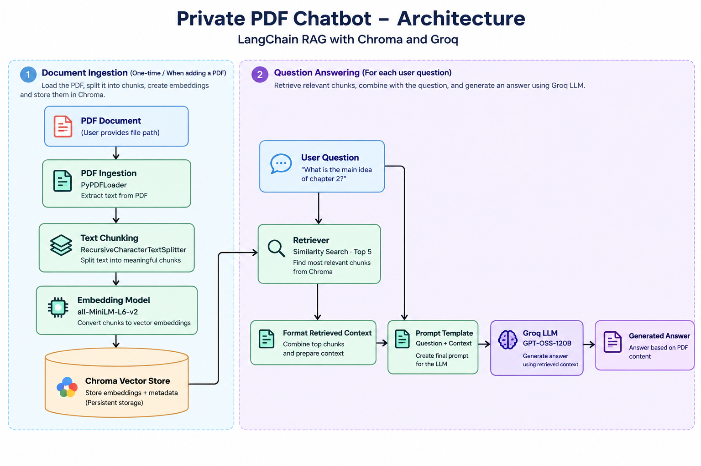
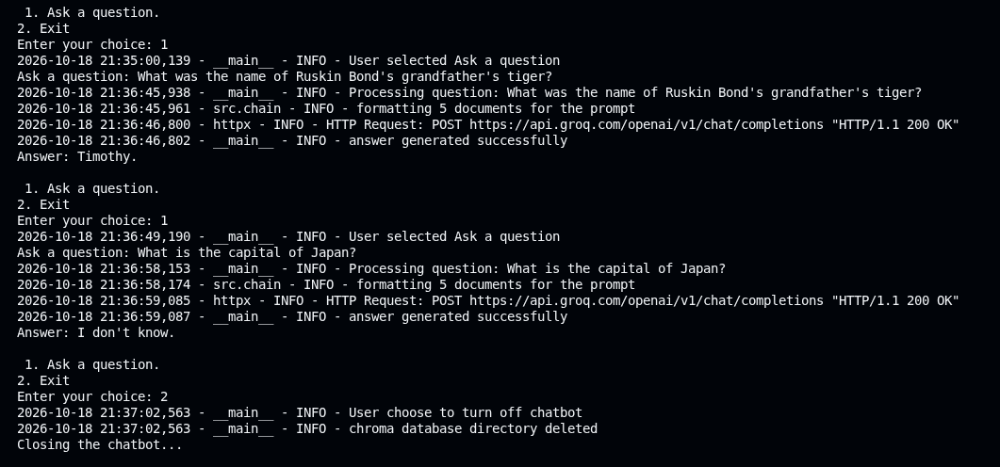

# Private PDF Chatbot — LangChain Edition

I built this project to explore Retrieval-Augmented Generation (RAG) and understand how LangChain simplifies the development of a document-based question-answering system.

The chatbot allows users to ask questions about a PDF and generates answers using relevant information retrieved from the document. I used LangChain, Chroma, Hugging Face embeddings, and the Groq API to build the pipeline.

## Overview

I previously implemented a RAG pipeline manually. In this project, I rebuilt the pipeline using LangChain to understand its abstractions, component integration, and LCEL-based orchestration.

The application processes a user-provided PDF, splits its text into chunks, generates embeddings, and stores them in a Chroma vector database. When a user asks a question, the retriever finds relevant chunks, which are passed to a Groq-hosted LLM to generate a context-grounded answer.

I also designed the prompt to instruct the model to acknowledge when the retrieved context does not contain enough information to answer a question.

## Architecture



**Pipeline:** PDF ingestion → Text chunking → Embeddings → Chroma vector store → Similarity retrieval → Context formatting → Prompt template → Groq LLM → Generated answer

## Tech Stack

- **Language:** Python
- **LLM framework:** LangChain and LangChain Expression Language (LCEL)
- **PDF ingestion:** PyPDFLoader
- **Text splitting:** RecursiveCharacterTextSplitter
- **Embedding model:** `sentence-transformers/all-MiniLM-L6-v2`
- **Vector database:** Chroma
- **LLM provider:** Groq API
- **Logging:** Python logging module
- **Evaluation:** Custom Python evaluation script

## Features

- Accepts a user-provided PDF.
- Splits documents into chunks of 800 characters with 120 characters of overlap.
- Generates local embeddings using a Hugging Face sentence-transformer model.
- Retrieves the top 5 relevant chunks using similarity search.
- Uses LCEL to compose the retrieval, prompt, and generation pipeline.
- Formats retrieved documents into context for the LLM.
- Instructs the model to abstain when the context is insufficient.
- Logs application activity and errors to the terminal and a log file.
- Includes a small evaluation dataset to test answerability behaviour.
- Deletes the local Chroma database when the user exits.

## Manual RAG vs. LangChain RAG

One of my goals was to compare my manual RAG implementation with a framework-based implementation.

| Aspect                 | Manual RAG                                 | LangChain RAG                                 |
| ---------------------- | ------------------------------------------ | --------------------------------------------- |
| Pipeline orchestration | Custom Python code connects the components | LCEL composes components into a pipeline      |
| Prompt construction    | Managed manually                           | `ChatPromptTemplate`                          |
| Context formatting     | Custom formatting logic                    | Integrated using `RunnableLambda`             |
| Component integration  | Explicitly managed in Python               | Standardized interfaces connect components    |
| Output parsing         | Custom response handling                   | `StrOutputParser`                             |
| Maintainability        | More control, but more orchestration code  | Modular composition and reusable abstractions |

**What I learned:** Implementing RAG manually helped me understand the underlying workflow, while LangChain reduced the amount of orchestration code needed to connect the components.

LangChain does not automatically improve retrieval accuracy. The results still depend on the documents, chunking strategy, retrieval configuration, prompt, and model.

## Project Structure

```text
PRIVATE_PDF_CHATBOT/
├── data/
├── docs/
│   ├── architecture.png
│   └── terminal-demo.png
├── evaluation/
│   ├── questions.json
│   ├── evaluate.py
│   └── results.json
├── logs/
├── src/
│   ├── config.py
│   ├── ingestion.py
│   ├── chunking.py
│   ├── embedding_model.py
│   ├── vector_store.py
│   ├── retrieval.py
│   ├── generation.py
│   ├── chain.py
│   └── main.py
├── .gitignore
├── requirements.txt
└── README.md
```

## Demo

I tested the chatbot with questions whose answers were present in the PDF and questions outside the document's scope.



In this example:

- **Answerable question:** The chatbot retrieves the name of Ruskin Bond's grandfather's tiger — Timothy.
- **Unanswerable question:** When asked for the capital of Japan, the chatbot responds that it does not know based on the provided context.

## Evaluation

I created a small dataset of eight questions to evaluate answerability behaviour. It includes questions expected to be answerable from the PDF and questions that require information outside the document.

| Evaluation Result   | Count |
| ------------------- | ----: |
| Passed              |     3 |
| Failed              |     2 |
| Needs review        |     3 |
| Errors              |     0 |
| **Total questions** | **8** |

These results are from my current evaluation run. The script performs a basic answerability check; it does not comprehensively measure semantic correctness or retrieval quality.

The results also revealed that some answerable questions were not answered successfully. This gives me a starting point for improving retrieval and evaluation.

## Limitations and Future Improvements

Based on my current implementation and evaluation, I would like to:

- Improve retrieval for questions whose answers exist in the PDF but are not retrieved.
- Evaluate semantic answer correctness in addition to answerability.
- Experiment with different chunking and retrieval configurations.
- Test the chatbot with a wider range of PDF documents.
- Improve handling of questions that require information beyond the source document.

## Security and Privacy

I perform PDF ingestion, embedding generation, and vector storage locally. However, the questions and retrieved context are sent to the configured Groq API for answer generation, so the application is not fully local or offline.

I would avoid submitting sensitive documents unless external processing is appropriate for the use case.
